# AutoFinX V5 Phase 1 — Market Intelligence Foundation Report

Date: 2026-10-16  
Mode: research/shadow only. No production execution permission was changed.

## Implemented

### Research contracts

- `app/Domain/MarketIntelligence/V5/ShadowPrediction.php`
  - Supports `UP`, `DOWN`, `SIDEWAYS`.
  - Supports 15m, 1h, 4h and 24h horizon contracts.
  - Rejects invalid Binance USDT-M symbols and out-of-range probabilities.
  - Requires probabilities when `probability_calibrated=true`.
  - Always emits `execution_authorized=false`.
- `app/Domain/MarketIntelligence/V5/ShadowOutcomeEvaluator.php`
  - Refuses to evaluate before `outcome_available_at`.
  - Evaluates actual direction only after the horizon has elapsed.
  - Contains no order, wallet, risk or exchange call.

### Pending database migration

`database/migrations/2026_10_16_120000_create_v5_research_shadow_tables.php` defines:

- `v5_market_observations`: validated OHLCV, taker volume, funding, open interest, provenance and hashes.
- `v5_shadow_predictions`: horizon, direction, optional calibrated probabilities, evidence, model/data status,
  outcome availability and later correctness.

Migration was **not executed**. It requires explicit owner approval before applying to any real database.

Models:

- `app/Models/V5MarketObservation.php`
- `app/Models/V5ShadowPrediction.php`

## Tests

Command:

```powershell
cd C:\xampplast\htdocs\auto_finx\autofinx-backend\backends
php artisan test --compact tests/Unit/MarketIntelligence/V5/ShadowPredictionTest.php
```

Result: **4 passed / 5 assertions**.

The existing V4 fresh evidence remains valid and unchanged. It showed checksum-validated Binance Vision 1h
OHLCV/funding for BTCUSDT, ETHUSDT and SOLUSDT, repeatable pinned Chronos-2 inference, and negative after-cost
test performance. No V5 accuracy is claimed from the four contract tests.

## Reuse and boundaries

The V5 contract is intentionally compatible with existing research components:

- trend scoring: `app/Domain/RatioBot/MultiWindowTrendScoringService.php`
- indicators: `app/Domain/Market/Indicators/Indicators.php`
- Chronos boundary: `app/Domain/MarketOpportunityBrain/Forecast/ForecastGateway.php`
- derivatives collector: `app/Domain/MarketContext/Collectors/BinanceDerivativesMetricsCollector.php`
- fail-closed policy: `app/Domain/MarketOpportunityBrain/Decision/ResearchDecisionPolicy.php`

No existing algorithm was deleted or rewired.

## Deliberate limitations in this phase

- No live Binance collector was enabled. Historical OHLCV/funding archives are available from the prior fresh
  experiment; validated multi-year order-book, open-interest, liquidation and taker-volume manifests are not yet
  available.
- No scheduler/cron registration was added. A production scheduler must not be enabled before a point-in-time
  collector adapter, rate-limit/backoff tests, deduplication tests and owner approval exist.
- No probabilities are fabricated from Chronos quantiles. Calibration remains unavailable until a development-only
  calibration artifact and validation gate are implemented.
- No Top-Three scanner or live order placement was implemented.

## Data pipeline contract for next increment

```mermaid
flowchart LR
  S[Binance historical/live adapter] --> R[Rate-limit + retry boundary]
  R --> V[Schema/gap/freshness validation]
  V --> H[Hash + provenance]
  H --> O[v5_market_observations]
  O --> F[Causal features + existing indicators]
  F --> M[AutoFinX / Chronos research forecasts]
  M --> P[v5_shadow_predictions]
  P -->|after horizon| L[ShadowOutcomeEvaluator]
```



## Next implementation task (approval required)

Implement a **research-only offline ingestion adapter** for the already verified Binance Vision archives. It should
populate observations in an isolated test database, prove deduplication/gap detection and preserve source hashes.
Only after that passes should a disabled-by-default 15-minute shadow command be proposed. No live endpoint, cron,
execution route or Top-Three recommendation should be added in the next step.

## Safety conclusion

Phase 1 foundation is contract/test complete but data ingestion and scheduler wiring remain intentionally gated.
There is no live trading path, no execution authorization, and no profitability claim.
