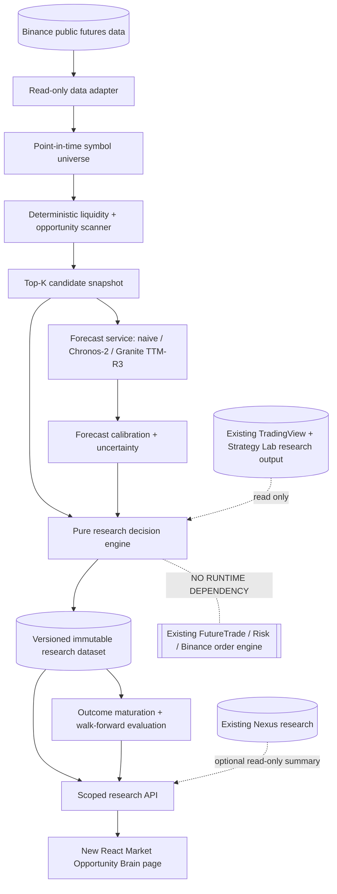

# Isolated architecture and owner boundaries

## Ownership grid

| Component | Owner | Allowed interface | Forbidden interface |
|---|---|---|---|
| Existing TradingView Prime / Pine webhook | Existing Future Trade | Optional read-only research status/strategy signal | No modifications to webhook signal or processing queue |
| Existing FutureTradeBotService/FuturesRiskService | Existing trading domain | Future *proposal* for independently approved adapter | No runtime calls from new Brain; no order tools |
| Existing Nexus | Nexus | Optional workspace-safe read-only evidence bridge | No autonomy escalation, shared cost budget override, auto-deploy |
| Existing ml-engine-v1 + V4 path aware | Historical research owner | Read-only datasets/metadata after permission; offline comparison | No refit/unseal/auto-promote existing champions |
| New market-opportunity-brain | New V4 discovery/forecast/decision domain | Produce candidate, prediction, research-decision datasets | Cannot sign API orders, transfer funds, alter risk or deploy |
| Existing Strategy Lab | Existing StrategyLab domain | Versioned read-only comparison | No arbitrary Pine execution or adapter SHA modification |

## Independent process boundaries

- Lightweight scanner: CPU-bounded worker, public feed requests with documented API budgets. Research-only. Dynamic universe is decoupled from allowlisted live symbols.
- Forecast worker: Python separate venv/process/service on research PC or dedicated host; GPU optional. Lazy-load pinned models. Not on production trading server.
- Orchestrator: idempotent state machine/queue for read-only pipelines, persistent failed/degraded states and resource quotas.
- API/UI: Laravel authenticated workspace-safe read endpoints, static read-only versioned JSON contracts. Browser cannot call model execution/order endpoints.
- Storage: local research parquet/SQLite/object store; if server persists summaries, only after approved migration; segregated from trading tables.

## Future connection (DESIGN ONLY; not built now)

A later version may expose a **signed research decision export** from an approved, immutable, calibrated model version. Existing risk/execution owners may choose to ingest it after a separate code review and operator authorization. It must independently validate symbol eligibility, freshness, source, idempotency, costs and all execution-risk constraints. No AI decision overrides exits, kill switches, webhook/mirror authority, max loss or protective orders. This phase explicitly excludes the adapter and all trading operations.
