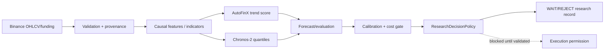

# AutoFinX Direction Research Handover

Date: 2026-10-16  
Status: evidence handover only — no new prediction engine implemented.

## 1. Evidence set

The following reports were consolidated and treated as documentation, not proof by themselves:

- `CURRENT_REPOSITORY_AUDIT.md`
- `ARCHITECTURE_AND_OWNERSHIP.md`
- `FRESH_V2_REPORT.md`
- `INDEPENDENT_AUDIT_2026-10-15.md`
- `IMPLEMENTATION_PROGRESS_V2.md`
- `TEST_EVIDENCE.md`, `RESULTS.md`, `DECISIONS.md`, `MASTER_SPEC.md`
- `COMPLETE_QUANT_AUDIT_2026-10-16.md`
- Fresh artifacts: `D:\autofinx-v4-fresh-research-v2-20261015-213345`,
  `D:\autofinx-v4-factor-ablation-20261015.json`, and `D:\autofinx-v4-robustness-20261015.json`.

Historical verdicts were not reused as performance proof. The fresh replay used checksum-validated Binance
Vision archives and a pinned Chronos-2 revision.

## 2. Verified source inventory

| Area | Exact source path | Verified responsibility/status |
|---|---|---|
| Real trend score | `app/Domain/RatioBot/MultiWindowTrendScoringService.php` | 3 candle-count windows; source-faithful replayed; Ratio Bot-specific |
| Forecast wrapper | `app/Domain/RatioBot/RatioBotBrainService.php` | confirmation/advisory wrapper; not a general direction engine |
| Recovery advisor | `app/Domain/RatioBot/RatioBrain.php` | recovery/shadow advisory logic, not a universal predictor |
| Indicators | `app/Domain/Market/Indicators/Indicators.php` | EMA/RSI/ATR/ADX/MACD/Bollinger/Stochastic/CCI; additive `adxWithDi()` |
| Chronos gateway | `app/Domain/MarketOpportunityBrain/Forecast/ForecastGateway.php` | fail-closed Python boundary |
| Chronos batch runner | `app/Domain/MarketOpportunityBrain/Forecast/ChronosBatchRunner.php` | batch forecast adapter; research boundary |
| Research policy | `app/Domain/MarketOpportunityBrain/Decision/ResearchDecisionPolicy.php` | WAIT/REJECT-only until calibration and cost contract exist |
| Binance public snapshot | `app/Domain/MarketOpportunityBrain/Adapters/BinancePublicSnapshotProvider.php` | public market snapshot adapter |
| Derivatives metrics | `app/Domain/MarketContext/Collectors/BinanceDerivativesMetricsCollector.php` | derivatives metrics collector; availability depends on configured source |
| Context classification | `app/Domain/MarketContext/Classification/RuleClassifier.php` | market regime/rule classification |
| Context snapshot | `app/Domain/MarketContext/SnapshotBuilder.php` | assembles market context |
| Future trade bot | `app/Domain/FutureTrade/FutureTradeBotService.php` | production execution strategy; not research evidence |
| Future backtest | `app/Domain/FutureTrade/FutureTradeBacktestEngine.php` | existing backtest path |
| Quick Trade | `app/Domain/Trading/QuickTradeService.php` | execution service |
| Quick Trade research | `app/Domain/Trading/QuickTradeResearchService.php` | read-only research/calibration path |
| Forecast math | `app/Domain/Trading/TradeForecastService.php` | ATR/forecast support used by existing trading domain |
| ML shadow features | `app/Domain/Ml/Shadow/ShadowFeatureBuilder.php`, `PatternFeatures.php` | shadow feature pipeline, not proven live predictor |
| ML shadow labels | `app/Domain/Ml/Shadow/FeatureLabelService.php` | label generation |
| ML shadow storage | `app/Domain/Ml/Shadow/MlCandleStore.php`, `app/Models/MlCandle.php` | persisted shadow candle data |
| Prediction storage | `app/Models/RatioBotForecastBacktest.php`, `app/Models/RatioBrainDecisionLog.php` | historical forecast/decision records |
| Execution/risk | `app/Domain/Trading/FuturesOrderIntentService.php`, `app/Domain/Risk/FuturesRiskService.php` | order intent and risk gates; excluded from research changes |
| Binance client | `app/Domain/Exchange/BinanceFuturesClient.php` | exchange API execution/data client |

Research-only Python sources:

- `audit/independent_v4_20261015_v2/experiment_v2.py`
- `audit/autofinx_v4_multifactor_event_research/features.py`
- `event_simulator.py`, `aggregation.py`, `factor_lab.py`, `combine_lab.py`, `robustness.py`

## 3. Fresh model comparison

| Candidate | Validation period | Test period | Samples/trades | Direction/TP metric | Brier | Net after cost |
|---|---|---|---:|---|---|---|
| Naive-last | Nov–Dec 2025 split | Dec 2025 | recorded in `FRESH_V2_REPORT.md` | numeric direction result in report | unavailable | negative test result |
| Directional persistence | Nov–Dec 2025 split | Dec 2025 | recorded in report | numeric direction result in report | unavailable | negative test result |
| Source-faithful AutoFinX | Nov–Dec 2025 split | Dec 2025 | 93 test decision windows | net mean **-0.4667%/trade**; max DD about **-39.5%** | unavailable | negative |
| Chronos-2 | Nov–Dec 2025 split | Dec 2025 | 93 test decision windows | net mean **-0.8810%/trade**; p10–p90 coverage 65.59% | unavailable | negative |
| Candle-body factor | development/validation/test | Dec 2025 | 66 test trades | TP **34.85%**; 23 TP / 42 SL / 1 liquidation | unavailable | negative test mean **-0.1041%** |
| Candle-range factor | same | Dec 2025 | 82 test trades | TP **25.61%**; 21 TP / 57 SL / 4 liquidation | unavailable | negative test mean **-0.4497%** |
| Trend-slope factor | same | Dec 2025 | 66 test trades | TP **25.76%**; 17 TP / 44 SL / 5 liquidation | unavailable | negative test mean **-0.4982%** |

Brier score was not available because Chronos-2 supplied quantiles, not calibrated directional probabilities;
the audit deliberately did not invent probabilities. Confidence intervals and Brier/ECE must be produced only
after a real calibration artifact is fit on development/validation data.

## 4. What V4 does and does not support

| Requirement | Status | Evidence |
|---|---|---|
| Multi-symbol scanning | Partial/research-only | fresh harness loops BTC/ETH/SOL; no verified production universal scanner |
| 15-minute refresh | Not verified | no fresh evidence of an operational V4 15m scheduler/data contract |
| 24-hour forecasting | Not verified | Chronos replay used defined short horizon; no production 24h forecast contract |
| Top-three ranking | Not verified as operational V4 | ranking concepts exist in specs, but no proven live pipeline/output |
| Direction separate from execution permission | Yes | research contracts/policy and architecture docs |
| Live trading connection | Existing trading domains only; V4 research disabled | policy is fail-closed |

## 5. Binance data availability

Verified usable in this audit: Binance Vision 1h OHLCV and funding-rate archives for BTCUSDT, ETHUSDT and
SOLUSDT (Oct–Dec 2025), checksummed and gap-checked. The research package does not contain a validated,
multi-year order-book, depth, open-interest, liquidation, or taker-volume manifest. `BinanceDerivativesMetricsCollector.php`
exists, but source freshness, historical coverage and reproducible point-in-time joins were not proven by this
experiment. OHLCV must not be treated as a substitute for those microstructure datasets.

## 6. Technical knowledge / Academy ingestion

No verified Binance Academy ingestion pipeline, corpus hash, source timestamp, or feature join was found in the
fresh evidence set. Technical-analysis formulas are implemented locally in `Indicators.php`; external documentation
is reference material, not an ingested model feature. Any future ingestion needs source URLs, retrieval time,
content hash, licensing/provenance and an offline reproducibility test.

## 7. Why direction and TP/SL are weak

- Fresh data validation passed, so malformed/gapped candles are not the primary cause.
- Chronos inference was repeatable and quantiles ordered, so model invocation failure is not the primary cause.
- Test TP rates were only 25–35% and SL/liquidation outcomes dominated.
- Directional thresholds and factor signals are not calibrated to post-cost outcomes.
- The 1h test contains regime dependence and limited sample size; one-bar latency and costs reduce marginal edge.
- Chronos quantiles were not valid directional probabilities; treating them as such would be leakage/overclaiming.
- Existing policy intentionally rejects uncalibrated or cost-unknown forecasts, producing WAIT rather than hiding
  an unproven direction.

## 8. Architecture diagram



## 9. Reproduction commands

```powershell
cd C:\xampplast\htdocs\auto_finx\autofinx-backend\backends
php artisan test --compact tests/Unit/MarketOpportunityBrain

cd C:\xampplast\htdocs\auto_finx
$env:PYTHONPATH=(Resolve-Path 'autofinx-backend\backends\audit').Path
python -m unittest discover -s 'autofinx-backend\backends\audit\autofinx_v4_multifactor_event_research\tests' -v
python -m autofinx_v4_multifactor_event_research.factor_lab `
  --root 'D:\autofinx-v4-fresh-research-v2-20261015-213345\raw' `
  --out 'D:\autofinx-v4-factor-ablation-20261015.json'
```

## 10. Prioritized research plan and acceptance gates

1. Freeze a new multi-year, point-in-time OHLCV/funding/order-book/OI/liquidation manifest.
2. Build a calibration artifact using development only; validate on a separate chronological partition.
3. Compare existing AutoFinX, naive and Chronos-2 with identical entries, exits, latency and costs.
4. Add microstructure ablations; do not infer them from candles.
5. Use a protected final holdout exactly once.

Acceptance requires, simultaneously: positive after-cost net expectancy with bootstrap CI lower bound above zero,
TP/SL ratio and drawdown limits predeclared before testing, calibrated probability error (Brier/ECE) below the
predeclared baseline, no leakage/gap failures, stable results across symbols/regimes, and all PHP/Python regression
tests green. Failure must be recorded as `REJECTED_NO_EDGE` or `INCONCLUSIVE`, never fixed by loosening thresholds.

## Proposed next implementation task

Research-only `CalibrationValidator` contract plus offline calibration tests (no production wiring): define input
forecast schema, chronological fit/validate boundaries, Brier/ECE/coverage outputs, minimum sample gates, and a
cost-aware expected-value rejection test. Do not emit execution-authorized decisions until that contract passes
independent review.

## Final status

**NO-GO for live trading or execution integration.** Existing algorithms and production trading paths were not
modified while producing this handover.
