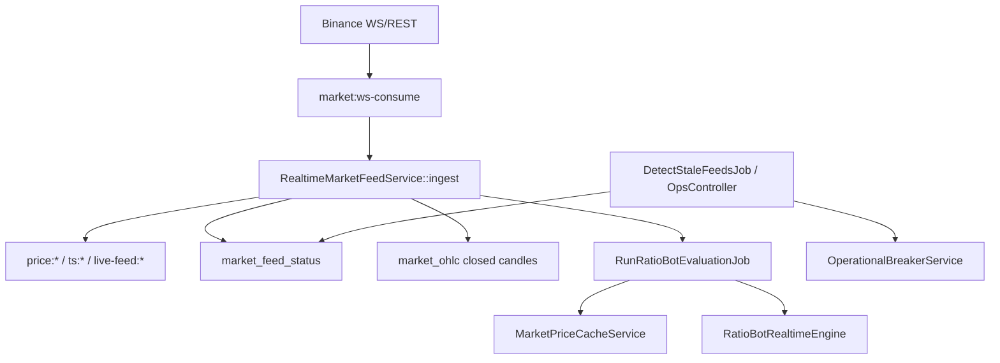
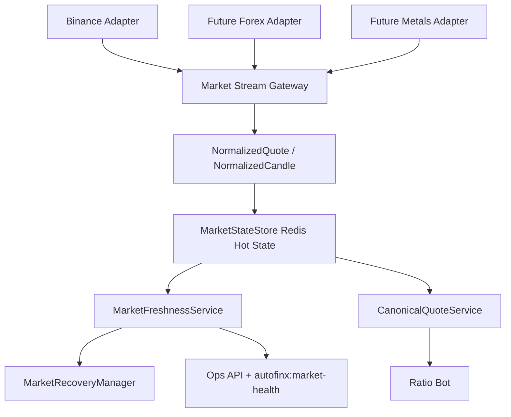

# Unified Market Data Engine

## Current Flow



## Confirmed Stale-Feed Failure Modes

- `DetectStaleFeedsJob` detected stale rows and opened breakers/RiskEvents, but did not request scoped recovery.
- `RunRatioBotEvaluationJob::handleStaleFeed` used `RatioBotStateService::block`, which disabled the bot config for a stale feed. A later fresh tick could leave the bot stopped unless another path manually restarted it.
- `OpsController::providerHealth` exposed global `MarketTick` freshness, not provider/instrument/stream health.
- Legacy Redis `price:*` and `ts:*` keys had no TTL and could survive after the live stream stopped.

## New Flow



## Redis Contract

- `autofinx:market:{provider}:{instrument}:quote`
- `autofinx:market:{provider}:{instrument}:health:{stream}`
- `autofinx:market:recovery:{provider}:{instrument}:{stream}`
- Legacy compatibility remains: `price:{exchange}:{symbol}`, `ts:{exchange}:{symbol}`, `live-feed:{exchange}:{symbol}`

Quote/trade TTL defaults to 120 seconds. Candle TTL defaults to 600 seconds.

## Recovery Semantics

Stale feed now means:

```text
block execution on old quote
mark stream RECOVERING
preserve Ratio Bot enabled/config state
let the dedicated websocket gateway reconnect
resume automatically when canonical quote is fresh
```

Operator command:

```bash
php artisan autofinx:market-recover BTCUSDT --provider=binance
```

Health command:

```bash
php artisan autofinx:market-health --provider=binance --instrument=BTCUSDT --details
```

## Forex/Gold Readiness

The core now supports canonical instruments, provider-symbol mapping, bid/ask/mid/spread quote semantics, market sessions, and market-closed health. Real MT5/broker connections still need provider-specific adapters and credentials.
